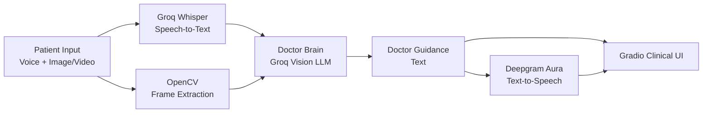

# AI Skin Specialist 🩺✨

> An AI-powered, multimodal clinical assistant that analyzes skin concerns through **voice**, **images**, and **video**, delivering interactive clinical guidance with voice response.

---

## 🌟 Key Features

- **🎙️ Voice-to-Text (Patient Voice)**: Transcribes patient speech accurately using **Groq Whisper** (`whisper-large-v3`).
- **👁️ Multimodal Visual Analysis (Doctor Brain)**: Analyzes skin images and extracts representative frames from skin videos via OpenCV using high-performance Vision LLMs on **Groq** (`qwen/qwen3.6-27b`).
- **🔊 Voice Synthesis (Doctor Voice)**: Generates human-like, reassuring doctor audio responses powered by **Deepgram Aura TTS** (`aura-2-thalia-en`).
- **💻 Modern Gradio Interface**: Clean, clinical-grade responsive UI with real-time audio playback, speech transcript display, and media preview.
- **🛡️ Responsible AI**: Built-in safety boundaries ensuring guidance is informational and non-diagnostic.

---

## 🏗️ Architecture & Workflow



---

## 🛠️ Tech Stack

- **Language & Runtime**: Python 3.12+
- **User Interface**: [Gradio](https://www.gradio.app/)
- **AI & Vision Models**: [Groq Cloud API](https://groq.com/) (Qwen Vision, Whisper)
- **Voice Synthesis**: [Deepgram](https://deepgram.com/) (Aura-2 TTS)
- **Computer Vision & Media**: OpenCV (`opencv-python`), PyDub, SpeechRecognition
- **Package Management**: [uv](https://docs.astral.sh/uv/) / pip

---

## 📁 Project Structure

```text
AI-SKIN-SPECIALIST/
├── brain_of_the_doctor.py    # Vision LLM logic, frame extraction & prompt management
├── voice_of_the_patient.py   # Speech recognition & Whisper transcription
├── voice_of_the_doctor.py    # Deepgram TTS audio synthesis & playback
├── main.py                   # Gradio application & custom UI styling
├── sample_image.jpeg         # Test sample image
├── pyproject.toml            # Project dependencies & configuration
└── README.md                 # Project documentation
```

---

## 🚀 Getting Started

### 1. Prerequisites
- Python 3.12 or newer
- [FFmpeg](https://ffmpeg.org/) installed and available in your system `PATH`
- API keys for:
  - [Groq Console](https://console.groq.com/)
  - [Deepgram Console](https://console.deepgram.com/)

### 2. Clone the Repository
```bash
git clone https://github.com/<your-username>/ai-skin-specialist.git
cd ai-skin-specialist
```

### 3. Install Dependencies

Using **uv** (recommended):
```bash
uv sync
```

Or using standard **pip**:
```bash
python -m venv .venv
# On Windows:
.venv\Scripts\activate
# On macOS/Linux:
source .venv/bin/activate

pip install -r pyproject.toml
```

### 4. Environment Configuration
Create a `.env` file in the root directory and add your API credentials:
```env
GROQ_API_KEY=your_groq_api_key_here
DEEPGRAM_API_KEY=your_deepgram_api_key_here

# Optional model overrides:
# GROQ_MODEL=qwen/qwen3.6-27b
# WHISPER_MODEL=whisper-large-v3
# DEEPGRAM_TTS_MODEL=aura-2-thalia-en
```

### 5. Launch the Application
```bash
# Using uv:
uv run python main.py

# Or directly with activated virtualenv:
python main.py
```
Open your browser and navigate to the local URL (typically `http://127.0.0.1:7860`).

---

## ⚠️ Medical Disclaimer

This project is intended **solely for educational and informational purposes**. It does not provide medical diagnoses, treatment plans, or professional medical advice. Users should always consult a board-certified dermatologist or qualified healthcare provider for any medical evaluation or urgent health concerns.

---

## 📄 License

This project is open-source and available under the [MIT License](LICENSE).
